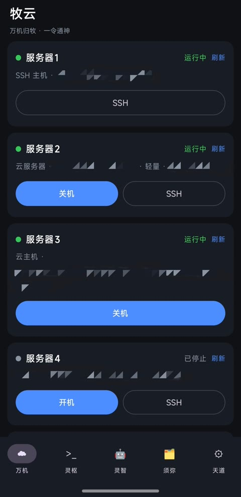
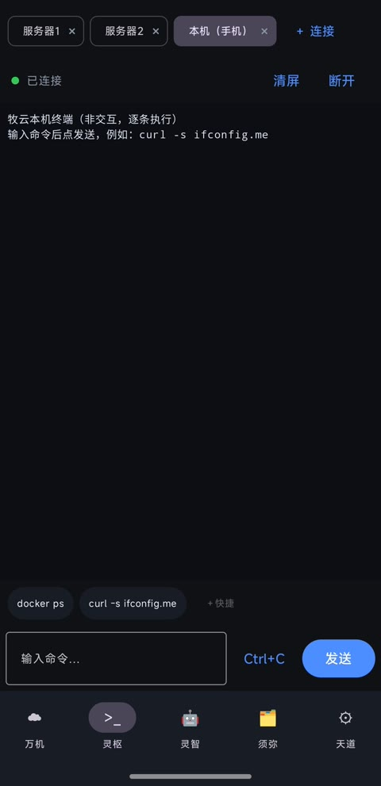
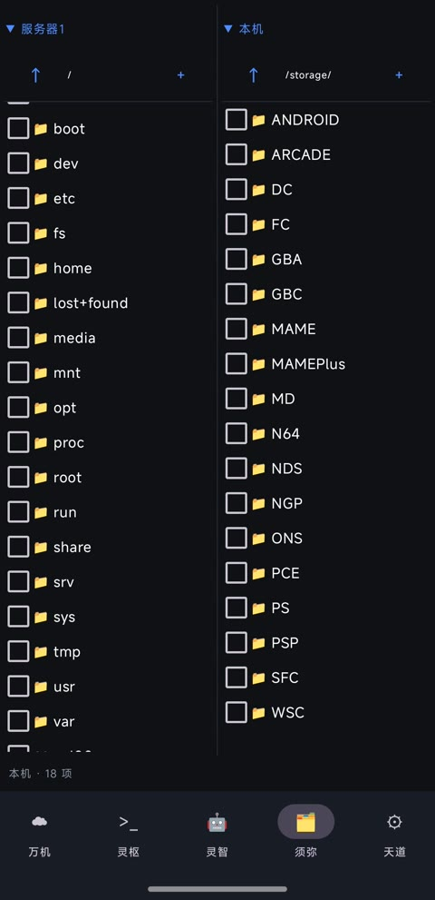
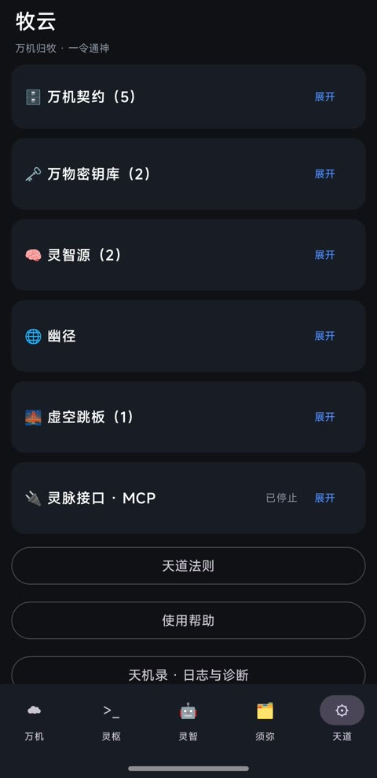

# 牧云（Muyun）

> **万机归牧 · 一令通神**
>
> 一个运行在 Android 上的「多云控制台」：把 instabox、GitHub Codespaces、阿里云、任意 SSH / SFTP 主机
> 收进一台手机，并提供 AI 助手与 MCP 接口统一调度。

> **项目定位：以作者自用为主，同时开源供他人学习与技术参考。**
> 当前版本 `1.0.0`（**不稳定版 / Unstable**），核心功能（多云管理 / 终端 / 文件 / AI / MCP / 跳板 / 代理）均已可用。
> 欢迎阅读代码、参考实现、自行修改；**不提供技术支持或使用指导**，后续不做更新承诺。
> **不稳定版**：接口、数据格式与行为可能随时变化；请勿用于生产环境或重要资产，风险自负。

> ⚠️ **使用前必读**：[安全声明](docs/安全声明.md) · [免责声明](#免责声明) · [权限与风险提醒](#权限与风险提醒)。
>
> 牧云是**高危运维工具**：可开关云主机、执行远程命令、读写服务器文件，并持有云厂商凭证与 SSH 私钥。
> 未经安全审计，**不建议直接用于生产环境**；无遥测、无后门、无数据回传，凭证仅存本机。

---

## 目录

- [为什么做这个](#为什么做这个)
- [功能总览](#功能总览)
- [界面结构](#界面结构)
- [架构设计](#架构设计)
- [快速开始](#快速开始)
- [服务器填写指南](#服务器填写指南)
- [AI 助手能力](#ai-助手能力)
- [MCP 接口](#mcp-接口)
- [错误处理与日志](#错误处理与日志)
- [安全设计](#安全设计)
- [构建与环境](#构建与环境)
- [常见问题](#常见问题)
- [安全声明](#安全声明)
- [权限与风险提醒](#权限与风险提醒)
- [免责声明](#免责声明)
- [维护说明](#维护说明)
- [许可证](#许可证)

---

## 为什么做这个

现有的云控制台要么只支持一家厂商（阿里云 App、GitHub App），要么只做 SSH 终端（Termius、JuiceSSH），
要么只能开代理（各种 socks 工具）。真正每天用的时候，你需要在 4~5 个 App 之间来回切换：

- 想开一台 instabox 沙箱 → 打开浏览器控制台
- 想连 Codespaces → 打开 GitHub App 或桌面端
- 想传个文件到 NAS → 换 SFTP 客户端
- 想开代理 → 再换一个 App
- 想知道机器状态 → 回控制台刷新

**牧云把这些收进一个 App**，并且把「操作」抽象成统一动作，交给 AI 或 MCP 客户端调度：

> 「把 kata 的状态读一下，如果挂了就开机，然后把这个文件传上去」

---

## 功能总览

### 万机（多云管理）

| 厂商 | 状态 | 开关机 | SSH | 文件 |
|---|---|---|---|---|
| **instabox** | ✅ | ✅ | ✅ 免密 | ✅ |
| **GitHub Codespaces** | ✅ | ✅ | ✅ gh 隧道 | ✅ |
| **阿里云 ECS** | ✅ | ✅ | ✅ | ✅ |
| **阿里云轻量应用服务器** | ✅ | ✅ | ✅ | ✅ |
| **自定义 SSH 主机** | ✅ | 可选 HTTP 接口 | ✅ | ✅ |
| **仅 SFTP 主机**（如 Pterodactyl 面板） | ✅ | 可选 HTTP 接口 | ❌ | ✅ |

- 每台机器独立刷新、独立超时、独立跳板
- 状态永不回退：查询失败保留上次已知状态（内存 + 磁盘）
- 关机机器自动过滤（须弥/幽径只显示可用的）

### 灵枢（终端）

- 多标签 SSH 终端，标签可切换/关闭
- **本机终端**：直接在手机上执行 shell（`curl`、`ping` 等）
- 输出可长按选中复制
- 长行自动缩小字号
- ANSI 控制序列自动清洗

### 灵智（AI 助手）

- **多供应商**：可保存多个 OpenAI 兼容供应商，一键切换
- **模型自动发现**：填入 Base URL + Key 即可拉取模型列表
- **视觉记忆**：按模型记住「是否支持图片」，重启后保留
- **附件**：任意类型文件，落盘并告知 AI 真实路径（字节不进上下文）
- **工具调用**：开关机 / SSH / SFTP / 代理 / 跳板 / 配置 / 密钥库 / 日志
- 对话历史、导出、删除、重生成
- 运行状态提示（思考中 / 执行命令中 + 实时秒数）

### 须弥（文件）

双栏文件管理器，左右独立选择「本机 / 云机 / Codespaces」：

- 单击文件夹进入，双击文件打开，长按菜单
- **复制到对栏**（本机↔云机、云机↔云机、Codespaces）
- 批量选择、批量删除
- 递归下载整个文件夹（进度条）
- 本地 ZIP 解压
- 下载目录：`/Download/muyun/`

### 幽径（代理）

- 每台云机可开一个 SOCKS5 隧道，走 SSH `direct-tcpip`
- 端口可自定义并**记忆**
- 出口 IP / 延迟 / 带宽测速
- **代理与跳板同机时，自动暂停状态轮询**，避免抢上行带宽

### 虚空跳板

- 独立管理跳板机（任意 SSH 主机）
- 按云单独绑定：**只有配了跳板的账号才走跳板**，其余直连
- 隧道健康检查、失败重试一次、15 秒冷却
- SSH keepalive 30 秒

### 万物密钥库

- 任意键值对 / 整段文本（私钥、JSON 配置）
- 三级可见性：

| 可见性 | AI / MCP |
|---|---|
| 公开 | 总是可读 |
| 秘密 | 需开启「暴露完整凭据」 |
| 私有 | 仅 App 内使用 |

### 灵脉（MCP）

- 内置 MCP 服务（JSON-RPC over HTTP）
- 默认端口 `4000`，可改
- Token 可自定义，**留空 = 不校验**
- 只监听 `127.0.0.1`
- **AI 与 MCP 共用同一套工具实现**（`ToolRuntime`），能力不会漂移

### 天机录（日志）

- 分类日志：`CLOUD / SSH / SFTP / PROXY / AI / MCP / POLL / APP`
- 级别：`I` 正常 / `W` 可恢复 / `E` 失败
- 环形缓冲 500 条 + **落盘** `diag.log`（256KB 轮转）
- 崩溃时自动附带最近 80 条日志到 `crash.log`
- 一键复制 / 导出 / 分享

---

## 界面预览

| 万机 | 灵枢 |
|---|---|
|  |  |

| 须弥 | 灵智 | 天道 |
|---|---|---|
|  |  |  |

> 截图为脱敏示例：机器名与地址已替换或打码，仅展示界面结构。

## 界面结构

底部 5 个 Tab：

```
万机   灵枢   灵智   须弥   天道
 │      │      │      │      │
 │      │      │      │      └── 设置：万机契约 / 万物密钥库 / 灵智源 / 幽径 / 虚空跳板 / 灵脉 MCP / 天机录
 │      │      │      └───────── 双栏文件（本机 ↔ 云机 ↔ Codespaces）
 │      │      └──────────────── AI 助手
 │      └─────────────────────── 多标签终端
 └────────────────────────────── 云机列表
```

---

## 架构设计

### 分层

```
core/         纯工具层（无 UI 依赖）
  AppError      统一错误模型 + 异常映射
  Diag          诊断日志（分类/级别/去重/落盘）
  Timeouts      超时与重试集中定义
  CrashGuard    全局崩溃捕获

data/
  StoreRepository  配置持久化唯一入口

cloud/
  CloudProvider    云厂商统一接口
  Providers        Instabox / Aliyun / Http 三种实现

feature/
  ai/       AiCore（解析） AiPrompt（提示词） ChatStore（会话） AiAgent（循环）
  mcp/      McpTools（工具 Schema） McpVm（生命周期）
  files/    FileOps / Transfer / PaneNav / FilePaneVm
  proxy/    ProxyProbe（测速）
  power/    PowerWait（开关机等待）
  terminal/ Ansi / TermStore / TermSession
  tools/    ToolRuntime（AI 与 MCP 共用）

ui/
  components/  Chat.kt（气泡 + Markdown 渲染）
  screens/     FilesScreen / TerminalScreen / AiScreen / SettingsScreen

MainActivity.kt   仅导航与少量组件（约 417 行）
MainVm.kt         业务编排（约 1900 行，逐步瘦身）
```

### 关键约定

1. **错误**：业务层返回/抛出 `AppError`；UI 只展示 `userMessage()`，技术细节进 `Diag`
2. **日志**：统一 `Diag.i/w/e(category, msg)`，1 秒内相同消息去重
3. **持久化**：只能通过 `StoreRepository`
4. **云厂商**：新增 = 新增一个 `CloudProvider` 实现，不改主流程
5. **文件路径**：统一 `PaneNav.childPath/parentPath/defaultPath`
6. **AI 工具**：`AiPrompt`（提示词）、`AiCore`（解析）、`McpTools`（Schema）三处对照
7. **工具执行**：只有 `ToolRuntime` 一个实现，AI 与 MCP 共用

### 为什么重视「初始化顺序」

Kotlin 的属性和 `init` 块按书写顺序执行。曾经两次因为「`init` 里用到的属性声明在 `init` 之后」导致启动即崩溃：

- `visionModels`（视觉记忆丢失）
- `termSession`（启动闪退）

现在这类字段统一放在类顶部并加注释。

---

## 快速开始

1. 安装 APK
2. 打开「天道 → 万机契约 → ＋ 添加」
3. 按 [服务器填写指南](docs/服务器填写指南.md) 填写
4. 回到「万机」页，卡片出现即成功

---

## 服务器填写指南

完整字段说明见 [`docs/服务器填写指南.md`](docs/服务器填写指南.md)，包含：

- GitHub Codespaces（只需 Token）
- instabox（API Key + 可选 SSH）
- 阿里云 ECS / 轻量（AccessKey + 地域 + 实例 ID）
- 自定义 SSH / 仅 SFTP 主机（含 Pterodactyl 面板开关机示例）
- 跳板机
- 万物密钥库
- 常见错误对照表

---

## AI 助手能力

系统提示词由 `AiPrompt` 生成，包含：

- 账号完整配置（含凭据，取决于「暴露凭据」开关）
- 运行概况
- 机器列表（名称 + 类型 + 状态 + 能力）
- 动作清单与规则

支持的动作为（AI 与 MCP 共用）：

```
local_run       手机本机执行命令
power_on/off    开关机
ssh_run         在机器上执行命令
term_list       列出终端会话
term_read       读终端输出（支持 since 增量）
term_write      向指定终端写命令
sftp_list/read/write/delete/mkdir/rename/chmod
sftp_download   下载到手机
sftp_copy       机器之间复制（文件/目录）
file_upload     手机文件直传机器（二进制安全）
proxy_on/off/list
jump_list/set/delete/test/assign
vault_list/get/set
config_get/set
logs / crash_log
```

---

## MCP 接口

```
POST http://127.0.0.1:4000/mcp
Authorization: Bearer <token>    # Token 留空则不需要
Content-Type: application/json

{"jsonrpc":"2.0","id":1,"method":"tools/list"}
```

- `GET /` 返回服务说明，便于探测
- `GET /health` 返回 `{"ok":true}`
- 工具列表见 `feature/mcp/McpTools.kt`

---

## 错误处理与日志

### 错误分层

| 层 | 表现 |
|---|---|
| 云 API | 中文提示 + 原始异常进日志 |
| SSH/SFTP | 识别 `subsystem`（未开 SFTP）、`auth`（认证失败）、`timeout`、**主机密钥不匹配** |
| AI | 429 限流、401/403 鉴权、断流重试提示 |
| 文件 | 权限不足、路径不存在、传输失败项数 |
| 网络 | 区分可重试与不可重试 |

### 日志查看

`天道 → 天机录`：可查看、复制、导出。
崩溃后重开 App，日志不会清空（已落盘）。

---

## 安全设计

| 项 | 设计 |
|---|---|
| 凭据存储 | Android Keystore AES-256-GCM 加密后写入本机 SharedPreferences，**不硬编码、不上传** |
| SSH 主机密钥 | **TOFU**：首次连接记录 SHA-256 指纹，之后指纹不一致直接拒绝连接（防中间人）；指纹存于 `known_hosts` |
| 向 AI/MCP 暴露 | 默认关闭；新条目默认「受保护」（打码），可手动改「公开」 |
| MCP 监听 | 默认仅 `127.0.0.1`；**首次运行自动生成随机 Token**；清空 Token 启动时会二次确认 |
| 文件权限 | 上传用 SAF；下载用公共目录；浏览全盘需手动授予「所有文件访问权限」 |
| 仓库 | 不含任何真实 Token / IP / 主机名（已扫描校验） |

---

## 构建与环境

### 要求

- JDK 17
- Android SDK 37（build-tools 37.0.0）
- Gradle 9.4.1
- minSdk 26 / targetSdk 36

### 命令

```bash
export JAVA_HOME=/path/to/jdk17
export ANDROID_HOME=/path/to/android-sdk
export GRADLE_USER_HOME=/path/to/gradle-home
./gradlew assembleDebug
```

产物：`app/build/outputs/apk/debug/app-debug.apk`

### 内嵌 gh CLI

`app/src/main/jniLibs/arm64-v8a/libgh.so` 是 Linux arm64 静态编译的 `gh`，用于 Codespaces 隧道。
仓库**不包含**该二进制（体积原因），克隆后执行：

```bash
bash scripts/fetch-gh.sh
```

---

## 常见问题

| 现象 | 处理 |
|---|---|
| 该主机未开启 SFTP 服务 | NAS 控制面板启用 SFTP（群晖：文件服务 → SFTP） |
| SSH 认证失败 | 检查用户名/密码/密钥；instabox 是免密，密码框留空 |
| 阿里云查不到实例 | 检查产品类型（ECS / 轻量）、地域、实例 ID |
| 状态一直「未知」 | 看天机录：跳板不可用 / 面板超时 / 未返回状态字段 |
| 代理很卡 | 若代理与跳板同机，App 会在代理期间暂停轮询；也可换跳板 |
| MCP 连不上 | 确认服务已启动、URL 为 `/mcp`、Token 一致 |
| 终端读不到内容 | 需先在灵枢页打开终端；多会话时用 `session`/机器名/序号指定 |

---

## 安全声明

> 完整版见 [`docs/安全声明.md`](docs/安全声明.md)

1. **高危工具**：具备开关云主机、执行远程命令、读写服务器文件的能力，并持有云厂商凭证与 SSH 私钥。
2. **无担保**：按「现状」提供，不提供任何形式的安全担保；作者不对凭证泄露、数据丢失、服务器损坏或任何直接/间接损失承担责任。
3. **未经安全审计**：密钥存储、权限控制等机制仍在完善中，**不建议在生产环境或存放重要资产的服务器上直接使用**。
4. **无遥测/后门**：不含遥测、后门、广告 SDK 或数据回传逻辑；所有凭证仅存本机，不上传任何第三方。欢迎审计源码验证。
5. **严禁非法用途**：仅可管理你拥有合法权限的服务器与账号。
6. **生产环境建议**：自行 fork 后审计并加固；使用 RAM 子账号、SSH 密钥对、MCP Token、受保护/私有可见性。

### 凭据存储现状

| 项 | 实现 |
|---|---|
| 位置 | 本机 SharedPreferences（App 私有目录） |
| 加密 | **Android Keystore AES-256-GCM** |
| 范围 | 服务器(entries) / 密钥库(vault) / AI 供应商(aiProviders) / 跳板(jumpHosts) / aiKey |
| 密钥 | 不可导出；卸载或清数据后不可恢复 |
| 备份 | 需「导出配置」（明文 JSON，请自行加密保管） |
| MCP | **默认随机 Token**；手动清空才关闭校验 |

---

## 权限与风险提醒

本 App 为了完成「管理服务器 + 文件传输 + 后台保活」，申请了**高于普通应用**的权限，请务必了解：

| 权限 / 能力 | 用途 | 风险 |
|---|---|---|
| **所有文件访问权限**（MANAGE_EXTERNAL_STORAGE） | 在 `/Download/muyun` 下预览/下载文件、供 AI 读写附件 | 可读取手机存储中的任意文件；**仅在你信任本 App 时开启** |
| **忽略电池优化 / 自启动** | 代理、SSH 隧道、MCP 服务在后台存活 | 会持续占用少量电量与网络 |
| **网络访问** | 连接云厂商 API、SSH/SFTP、AI 供应商 | 你的服务器凭据会用于建立这些连接 |
| **本地存储凭据** | 保存服务器密码、Token、API Key（AES-GCM 加密） | 加密密钥在 Android Keystore，卸载/清数据后**不可恢复** |
| **导出配置** | 换机/备份 | 导出文件是**明文 JSON（含凭据）**，请勿上传公开位置 |
| **MCP 服务** | 供本地 AI 客户端调用 | 默认仅监听 `127.0.0.1`；Token 留空表示不校验，同一手机上的其他 App 也可能访问 |

### 使用提醒

1. **先在测试机 / 非生产环境验证**，确认无误再管理生产服务器
2. 不要在公共 Wi-Fi 下开启 MCP 或代理
3. 定期用「导出配置」做备份（Keystore 无法随系统备份迁移）
4. 不要把导出的 JSON、截图中的 Token 发到公开渠道
5. 关闭不再使用的代理/跳板/MCP，减少后台资源占用
6. 对 AI/MCP 使用「受保护/私有」可见性，避免凭据被读取或误操作

---

## 免责声明

1. **本软件按「现状」提供**，不附带任何明示或暗示的担保，包括但不限于适销性、特定用途适用性与不侵权担保。
2. **使用风险自负**。因使用本软件导致的服务器故障、数据丢失、配置损坏、费用产生、账号封禁或其他任何直接/间接损失，作者不承担责任。
3. 本软件会按你的配置执行**开机、关机、命令执行、文件删除、权限修改**等操作；AI/MCP 调用同样具有这些能力，请自行控制可见性与授权范围。
4. 本软件与 instabox、GitHub、阿里云、Pterodactyl 等第三方服务**无任何隶属或背书关系**；使用这些服务需遵守其各自的服务条款与计费规则。
5. 请确保你**有权管理**所配置的服务器与账号；不得用于未授权的入侵、扫描或破坏行为。
6. 第三方依赖（SSHJ、OkHttp、BouncyCastle、GitHub CLI 等）遵循各自许可证，详见 [依赖许可](docs/依赖许可.md)。

---

## 开源与支持

- **许可证**：Apache License 2.0（见 [LICENSE](LICENSE) 与 [NOTICE](NOTICE)）
- **项目性质**：作者自用为主，开源供学习与技术参考
- **使用方式**：你可以阅读、学习、fork、自行修改；也可以按自己的需要部署使用
- **不提供支持**：不提供技术支持、答疑、定制、部署指导或问题修复承诺
- **不保证维护**：可能长期不更新，也可能随时归档或删除
- **Issue / PR**：不保证查看或回复；合并与否由作者自行决定
- **免责**：使用风险完全自负，详见 [安全声明](docs/安全声明.md) 与 [免责声明](#免责声明)

> 这个项目首先是为解决作者自己的需求而写，其次才是给他人参考。
> 如果你需要长期稳定、有支持的运维工具，请选择商业产品。

---

## 维护说明

- **状态**：自用为主，功能基本完成，可能随时停止维护
- **更新范围**：仅作者个人需要时的修补，不对外承诺
- **不保证**：发版节奏、新功能、问题响应、向后兼容的数据迁移
- **反馈**：不保证处理
- **分支策略**：`main` 为唯一分支，`vX.Y.Z` 为发布标签

---

## 版本策略

采用语义化版本，详见 [`docs/版本策略.md`](docs/版本策略.md)。
当前版本 `1.0.0`（**不稳定版 / Unstable**）（新仓库重置版本号）。

## 许可证

[Apache License 2.0](LICENSE)。你可以自由使用、修改、分发（需保留版权与 NOTICE 声明）。

> 许可证赋予的是**法律许可**，不代表作者提供任何支持或担保。
> 项目定位仍是「自用为主、开源供学习参考」；当前为 **1.0.0 不稳定版**，请勿用于生产环境。
